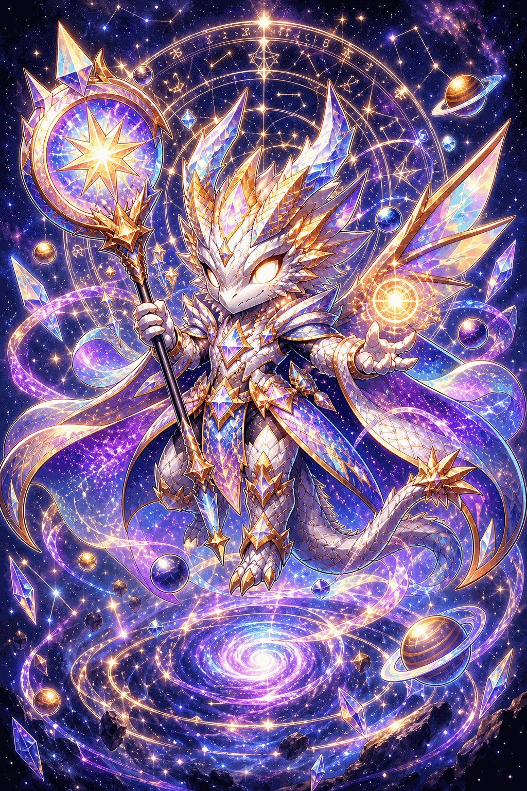
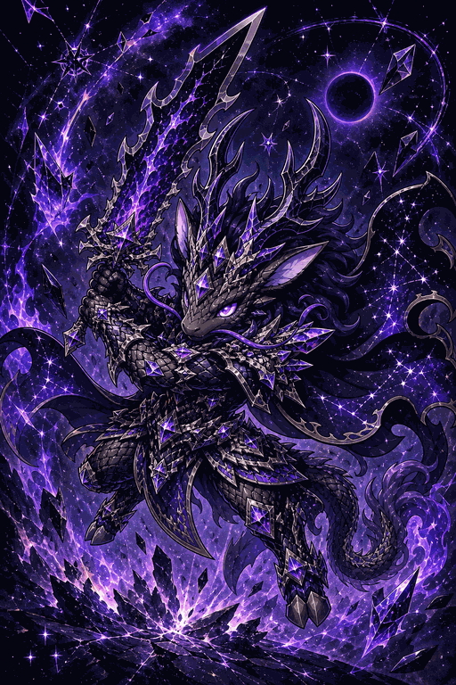
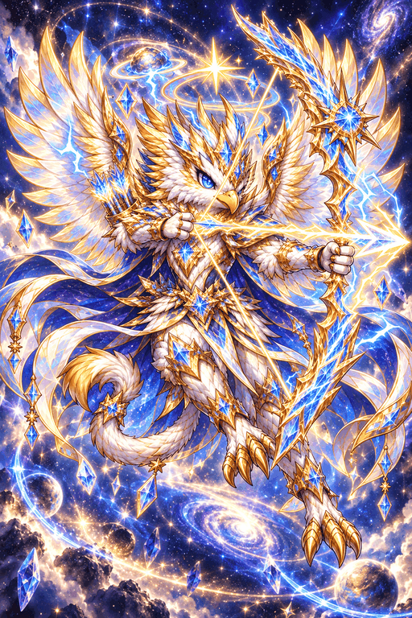
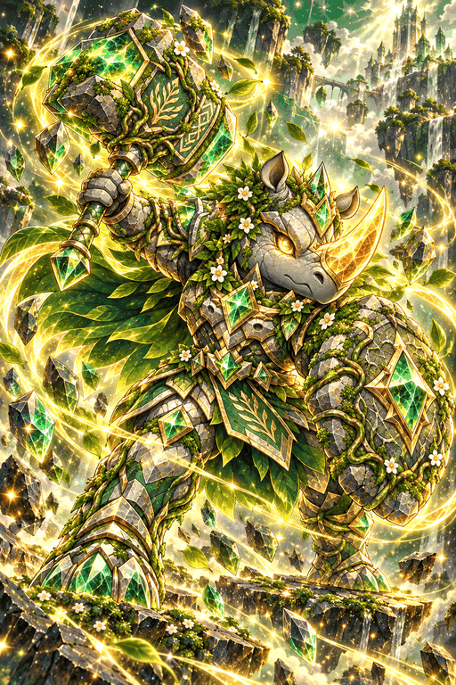

# 냥냥 용병단

> 고양이 용병단을 꾸려 성 밖의 위협을 몰아내는 **방치형 가챠 RPG**

전투는 자동으로 돌아가고, 플레이어(단장)는 **누구를 편성하고 무엇을 키울지**만 정한다.
모바일 세로 화면 기준의 2D 게임이고, 브라우저에서 설치 없이 바로 플레이할 수 있다.

**▶ [플레이하기 (Verse8)](https://verse8.io/x3d3X9K)**

  
  
  
  
  

## 세계관

별이 떨어진 날, 세상은 조용해졌다. 쪼개진 별의 조각은 짐승과 쇠붙이, 사람에게 스며들었고
견디지 못한 것들은 괴물로 변했다. 사람의 나라는 성벽 안으로 물러났고, 성 밖의 일은
값을 받고 대신 나가는 용병들이 맡는다. 조각은 서로를 부른다 — 부르면 찾아온다.
그것이 용병단이 서는 법이다.

## 어떤 게임인가

- **자동 전투 + 스테이지 돌파** — 400단계 메인 스테이지를 따라 올라가며 보스를 쓰러뜨린다.
  접속하지 않아도 방치 보상이 쌓이고, 절전 모드도 있다.
- **용병 소환** — 꼬마 햄찌 같은 N등급부터 전설의 **LR**까지 6단계 등급, 용병 35종.
  전사·궁수·마법사 3개 직업과 불·물·풀·빛·암 5속성이 있고, 같은 용병을 또 뽑으면 레벨이 오른다.
- **스킬과 장비** — 스킬 32종, 장비 6부위(무기·방어구·장신구·부적·깃발·유물). 제작대에서 소환하고 강화한다.
- **성장 콘텐츠** — 황금 광산·보물 창고·용광로·수정 동굴·시련의 탑 **5종 던전**,
  끝없이 오르는 **무한의 탑**, 다른 단장과 겨루는 **아레나**.
- **연합(길드)** — 연합원과 주간 연합 보스를 함께 두들기고, 채팅과 친구 기능으로 이어진다.
- **퀘스트 체인과 컬렉션** — 퀘스트로 던전·장비 칸·배속이 하나씩 열린다. 도감, 출석, 시즌 패스, 이벤트까지.
- **5개 언어 지원**, 클라우드 세이브.

## 신경 쓴 부분

- **무과금도 끝까지 갈 수 있는 경제 설계** — 뽑기 재화가 어디서 얼마나 나오는지 장기 예산을 잡고,
  콘텐츠를 추가할 때마다 다른 배출을 줄여 균형을 맞췄다. 시뮬레이터로 수치를 검증했다.
- **에셋 파이프라인** — 용병 일러스트, 전투 스프라이트, 배경, 스토리 컷, UI 킷, 효과음과 BGM까지
  AI 생성 에셋을 프롬프트부터 설계하고 게임에 맞게 가공했다.
- **광고는 선택 사항** — 강제 노출 광고와 부활 광고는 없고, 유저가 버튼을 눌렀을 때만 나오는 보상형 광고만 있다.
- **라이브 서비스 운영** — 출시 이후 신규 LR 용병 3종과 새 시즌 패스를 담은 **천둥 업데이트(v1.4.0)** 를
  내놓고, 업데이트 안내·감사 우편·결제 오류 수정까지 운영 사이클을 돌렸다.

## 성과

- Verse8에 출시, 실제 유저 결제 발생: **1,800 VX (약 $18)**

## 제작 방식

기획과 구현 전 과정을 **바이브 코딩**(AI와 대화하며 개발)으로 만들었다.
게임 규칙과 밸런스 수치는 모두 데이터(JSON)로 분리해 두어, 코드를 건드리지 않고도 조정할 수 있다.

- 엔진: PixiJS 8 (전투) + 웹 UI
- 플랫폼: [Verse8](https://verse8.io)
- 서버: 랭킹·연합·결제 검증 등을 Verse8 서버 함수로 처리
